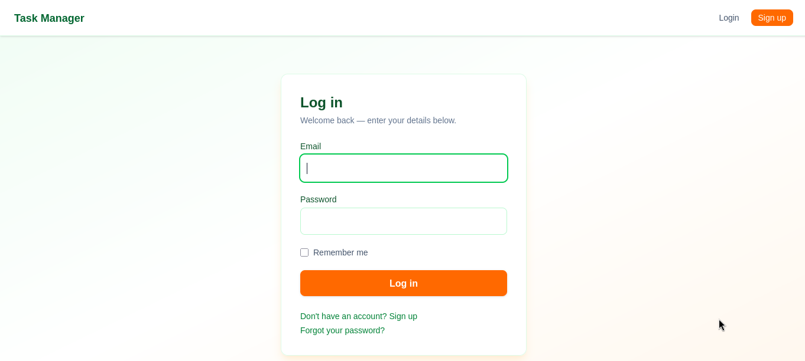
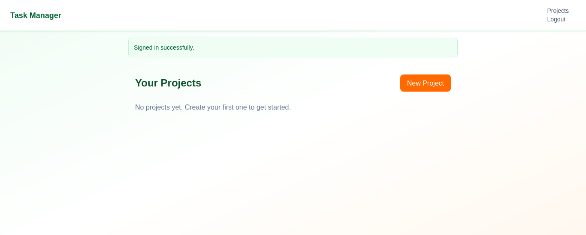

# Task Manager

A collaborative task management app built with Ruby on Rails — real-time updates across users via Hotwire, proper multi-user data modeling, and Devise authentication. No React, no Vue, no custom JS framework — just server-rendered HTML made snappy with Turbo and Stimulus.

**Live demo:** [your-deployed-url-here]

## Why I built this

Most "todo app" tutorials stop at basic CRUD on a single flat table. I wanted to go further: real ownership and collaboration between users, live updates when multiple people are viewing the same project, and inline editing that doesn't reload the page — while staying entirely within Rails' own tools instead of reaching for a JS framework.

## Features

- **Multi-user collaboration** — projects have an owner and any number of members; tasks can be assigned to any project member, not just the creator
- **Live updates across browsers** — when one user adds, completes, or edits a task, everyone else viewing that project sees it happen in real time, powered by Turbo Streams over Action Cable
- **Inline editing** — click a task title to edit it in place via Turbo Frames, no full-page form, no reload
- **One-click task completion** — toggling a task's status submits instantly through Turbo, not a traditional form round-trip
- **Live overdue indicators** — a Stimulus controller checks due dates client-side and updates "Due in 2h" → "Overdue" without any server request
- **Devise authentication** — full registration, login, session management, and password recovery
- **Authorization baked into queries** — users can only ever see/edit projects they own or belong to; scoping happens at the query level (`current_user.projects.find(...)`), not as an afterthought

## Tech stack

| Layer | Choice |
|---|---|
| Framework | Ruby on Rails 8 |
| Database | SQLite |
| Real-time | Hotwire (Turbo Streams, Turbo Frames) + Action Cable |
| Client interactivity | Stimulus |
| Styling | Tailwind CSS |
| Auth | Devise |

## Architecture notes

- **Three-way association model**: `User` → `Membership` ← `Project` → `Task`. A `Membership` join model (not a simple `has_and_belongs_to_many`) means project collaboration can later carry its own attributes (role, permissions, invited_at) without a schema rewrite.
- **Model-level broadcasting**: real-time sync is triggered by `broadcasts_to` directly on the `Task` model, not scattered across controller actions. Any code path that touches a task — console, background job, controller — broadcasts consistently, since the logic lives in one place.
- **Turbo Streams for every mutation**: create/update/toggle/destroy all respond with `turbo_stream` format, returning small DOM patches instead of full-page redirects, while still falling back to standard HTML redirects for non-JS clients.
- **Ownership enforced at the query layer**: every controller scopes lookups through `current_user.projects` / `current_user.owned_projects` rather than `Project.find(params[:id])` — a user requesting someone else's project ID gets a 404, not someone else's data.

## Local setup

```bash
git clone https://github.com/yourusername/task-manager.git
cd task-manager
bundle install
rails db:create db:migrate db:seed
bin/dev
```

Visit `http://localhost:3000`. Seeded accounts (see `db/seeds.rb`):
- `alice@example.com`
- `bob@example.com`

Open two browsers logged in as each to see real-time sync in action.

## Screenshots





## What I'd add next

- Task comments/activity log
- Due-date email reminders (Action Mailer + solid_queue)
- Drag-and-drop task reordering (Stimulus + Sortable.js)
- Project-level roles (admin vs. contributor permissions)

---

Built by Kepha